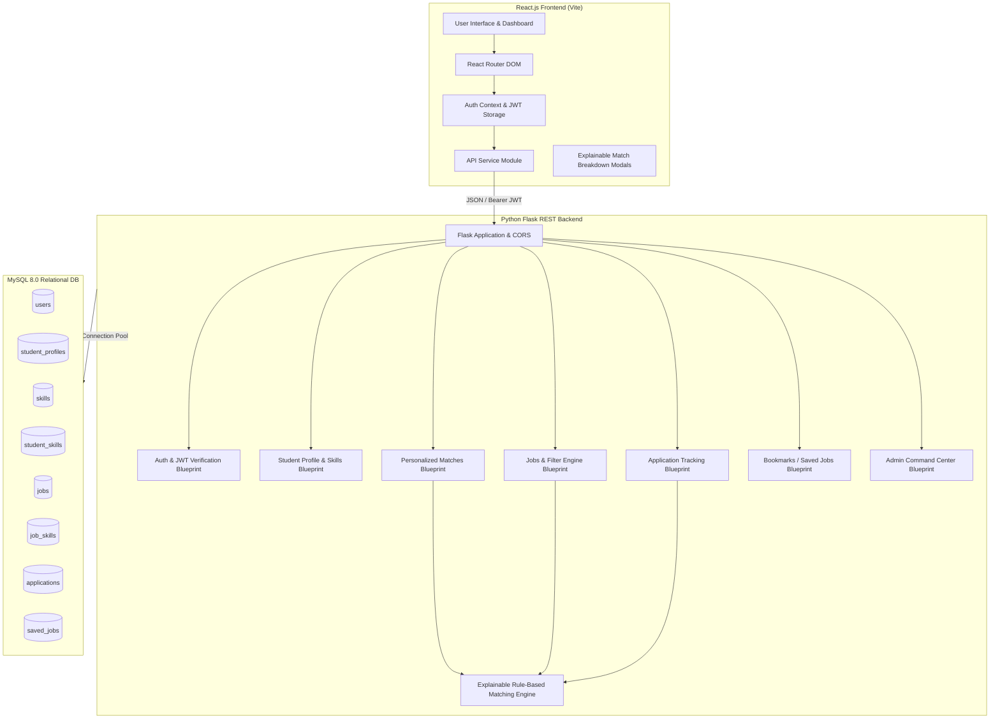

# SMART INTERNSHIP & JOB MATCHER

An end-to-end full-stack web application designed for engineering students to discover internships and job opportunities, featuring an **Explainable Rule-Based Matching Engine** that calculates transparent compatibility scores (0–100%) and provides clear algorithmic reasoning for every recommendation.

---

## 🌟 Architecture Overview



---

## 🛠️ Strict Tech Stack

| Layer | Technology | Description |
| :--- | :--- | :--- |
| **Frontend** | **React.js 19** (Vite) | Declarative component hierarchy with state hooks and context |
| **Styling** | **Vanilla CSS** | Modern tokens, glassmorphism, responsive grid, dynamic badges |
| **Backend** | **Python 3.13 / Flask** | Lightweight RESTful microframework with modular Blueprints |
| **Security** | **PyJWT & Werkzeug** | SHA-256 password hashing and secure stateless JWT bearer tokens |
| **Database** | **MySQL 8.0** | Normalized schema with foreign keys, cascading deletes, and indexes |

---

## 🧮 Explainable Rule-Based Matching Engine

Unlike opaque "black box" models, this engine calculates an **exact, explainable compatibility score from 0 to 100 points** for each student-job pair based on configurable criteria defined in `backend/config.py`.

### Scoring Breakdown (100 Points Total)

```
Total Match Score = Skills Match (40) + Academic Eligibility (25) + Education (15) 
                    + Role Preference (10) + Location Preference (5) + Experience (5)
```

1. **Skills Match (Max 40 Points)**:
   - Evaluates the overlap between student's verified skills and job's required skills.
   - $\text{Coverage Ratio} = \frac{|\text{Matched Skills}|}{|\text{Job Required Skills}|}$
   - $\text{Score} = \text{Coverage Ratio} \times 40$
   - Classifies skills into **Matched Skills** (✓) and **Missing Skills to Learn** (⚠).

2. **Academic Eligibility (Max 25 Points)**:
   - **CGPA Threshold (15 pts)**: Full 15 pts if student CGPA $\ge$ minimum job CGPA requirement; partial 7.5 pts if within 0.5; 0 pts otherwise.
   - **Graduation Batch (10 pts)**: Full 10 pts if graduation year matches target batch; 5 pts if $\pm 1$ year; 0 pts otherwise.

3. **Education / Branch Match (Max 15 Points)**:
   - Full 15 pts if candidate's branch is explicitly eligible or opening is "All Branches".
   - 12 pts for allied engineering branches.

4. **Role Preference Alignment (Max 10 Points)**:
   - Full 10 pts for exact title alignment (e.g., "Software Developer"); 8 pts for domain overlap (e.g., developer, engineer, analyst).

5. **Location Preference (Max 5 Points)**:
   - Full 5 pts if job location matches student preference or either is marked as "Remote" / "Any".

6. **Experience Compatibility (Max 5 Points)**:
   - Full 5 pts if student experience level satisfies the job requirement (e.g., Fresher).

### Explainability Output Example

When a student clicks **"Why this match?"**, the engine outputs:

```
Match Score: 90% (High Match)

Score Breakdown:
  • Technical Skills: 32.0 / 40.0 pts
  • Academic Eligibility: 25.0 / 25.0 pts
  • Branch Eligibility: 15.0 / 15.0 pts
  • Role Alignment: 8.0 / 10.0 pts
  • Location Alignment: 5.0 / 5.0 pts
  • Experience: 5.0 / 5.0 pts

Matched Skills (4):
  ✓ Data Structures   ✓ Java   ✓ Python   ✓ SQL

Missing Skills (1):
  ⚠ Docker

Key Strengths:
  ✓ CGPA 8.69 satisfies minimum requirement (7.50)
  ✓ Graduation year 2027 matches requirement (2027)
  ✓ Branch 'CSE' is directly eligible
  ✓ Location preference matches: Hyderabad
```

---

## 🗄️ Database Design (Relational Schema)

The database `smart_job_matcher` is normalized and indexed for performance:

1. **`users`**:
   - `id` (INT PK AI), `name` (VARCHAR), `email` (VARCHAR UNIQUE), `password_hash` (VARCHAR), `role` (ENUM: 'student', 'admin'), `created_at` (TIMESTAMP).
2. **`student_profiles`**:
   - `id` (INT PK AI), `user_id` (INT FK -> users.id), `branch` (VARCHAR), `cgpa` (DECIMAL(3,2)), `graduation_year` (INT), `preferred_location` (VARCHAR), `preferred_role` (VARCHAR), `experience_level` (VARCHAR).
3. **`skills`**:
   - `id` (INT PK AI), `name` (VARCHAR UNIQUE).
4. **`student_skills`**:
   - `student_id` (INT FK -> student_profiles.id), `skill_id` (INT FK -> skills.id). Composite Primary Key (`student_id`, `skill_id`).
5. **`jobs`**:
   - `id` (INT PK AI), `title` (VARCHAR), `company` (VARCHAR), `description` (TEXT), `location` (VARCHAR), `job_type` (VARCHAR), `experience_required` (VARCHAR), `minimum_cgpa` (DECIMAL(3,2)), `graduation_year` (INT), `eligible_branches` (VARCHAR), `salary_range` (VARCHAR).
6. **`job_skills`**:
   - `job_id` (INT FK -> jobs.id), `skill_id` (INT FK -> skills.id). Composite Primary Key (`job_id`, `skill_id`).
7. **`applications`**:
   - `id` (INT PK AI), `student_id` (INT FK -> student_profiles.id), `job_id` (INT FK -> jobs.id), `status` (ENUM: 'Applied', 'Under Review', 'Interviewing', 'Accepted', 'Rejected'), `applied_at` (TIMESTAMP). UNIQUE KEY (`student_id`, `job_id`).
8. **`saved_jobs`**:
   - `id` (INT PK AI), `student_id` (INT FK -> student_profiles.id), `job_id` (INT FK -> jobs.id), `saved_at` (TIMESTAMP). UNIQUE KEY (`student_id`, `job_id`).

---

## 🔌 Complete REST API Endpoints

### Authentication
- `POST /api/auth/register` — Register student or admin account
- `POST /api/auth/login` — Authenticate and receive JWT token
- `GET  /api/auth/me` — Retrieve active authenticated profile
- `GET  /api/auth/skills` — Retrieve global technical skills catalog

### Student Profile & Skills
- `GET    /api/student/profile` — Fetch student profile & verified skills
- `PUT    /api/student/profile` — Update CGPA, branch, grad batch, and preferences
- `GET    /api/student/skills` — Fetch current student's skills
- `POST   /api/student/skills` — Add skill by ID or custom name
- `DELETE /api/student/skills/<id>` — Remove skill from profile

### Job Listings & Filtering
- `GET    /api/jobs` — Browse jobs with keyword search, location, type, min match score, and sorting
- `GET    /api/jobs/<id>` — Get single job details with real-time match computation
- `POST   /api/jobs` — *(Admin)* Post new opportunity with required skills
- `PUT    /api/jobs/<id>` — *(Admin)* Update opportunity details and skills
- `DELETE /api/jobs/<id>` — *(Admin)* Delete opportunity listing

### Matching Engine
- `GET /api/matches` — Get personalized matches ranked by compatibility score
- `GET /api/matches/<job_id>` — Get full explainable match breakdown for a specific job

### Applications & Status Tracking
- `POST /api/applications` — Submit application for a job
- `GET  /api/applications` — List applications (student's own or all for admin)
- `PUT  /api/applications/<id>` — *(Admin)* Update application status in hiring pipeline

### Bookmarks / Saved Jobs
- `GET    /api/saved-jobs` — Fetch bookmarked jobs
- `POST   /api/saved-jobs` — Save/bookmark a job
- `DELETE /api/saved-jobs/<id>` — Remove a job from bookmarks

### Admin Management
- `GET /api/admin/statistics` — SQL aggregation metrics (students, jobs, applications, status breakdown, top skills, locations)
- `GET /api/admin/students` — Student directory with academic standings and skills
- `GET /api/admin/applications` — Applications review pipeline with stage dropdowns

---

## 🚀 Quick Start Guide

### 1. Prerequisites
- Python 3.10+
- Node.js 18+
- MySQL 8.0+

### 2. Configure Environment (`backend/.env`)
```env
MYSQL_HOST=127.0.0.1
MYSQL_PORT=3307
MYSQL_USER=root
MYSQL_PASSWORD=
MYSQL_DB=smart_job_matcher
JWT_SECRET=smart-matcher-jwt-secret-key-btech-2026
FLASK_ENV=development
PORT=5000
```
*(Supports either custom port 3307 or default port 3306 automatically).*

### 3. Initialize & Seed Database
```bash
cd backend
python seed.py
```

### 4. Start Backend Server
```bash
cd backend
python app.py
```
*API runs on `http://127.0.0.1:5000`*

### 5. Start React Frontend
```bash
cd frontend
npm install
npm run dev
```
*Web application runs on `http://localhost:3000`*

### Or run using one-click scripts on Windows:
Double click **`start_all.bat`** in the project root to launch both servers in separate terminal windows automatically.

---

## 🔑 Demo Credentials

| Role | Email | Password | Details |
| :--- | :--- | :--- | :--- |
| **Student** | `poojitha@matcher.com` | `student123` | CSE, CGPA 8.69, Batch 2027, 8 Verified Skills |
| **Student** | `aarav@matcher.com` | `student123` | CSE, CGPA 9.10, Batch 2026, Backend Specialist |
| **Student** | `sneha@matcher.com` | `student123` | IT, CGPA 8.25, Batch 2026, Frontend Specialist |
| **Admin** | `admin@matcher.com` | `admin123` | Full access to manage jobs, students, and pipeline |

*The login page also provides convenient one-click "Demo Student" and "Demo Admin" quick fill buttons.*
